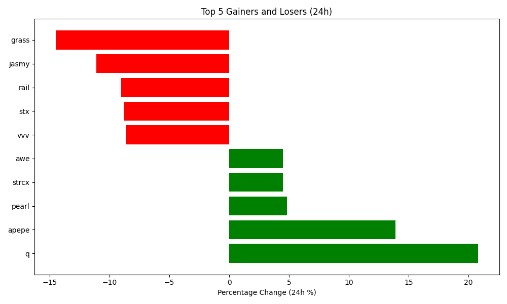

# Crypto Tracker (24h)
Author: Hitesh Agrawal

This repository automatically tracks the top 5 gaining, top 5 losing, and top 5 highest volume cryptocurrencies in the last 24 hours using the CoinGecko API, Python, Matplotlib, and GitHub Actions updates the below content everyday at midnight.

<!-- START_DYNAMIC_CONTENT -->
Last updated: 2026-10-25 02:36 UTC



**🚀 Top 5 Gainers (24h)**

| Rank | Coin | Price Change (24h %) | Volume (USD) | Current Price (USD) |
| :--: | :--: | :------------------: | :----------: | :-----------------: |
| 1 | cap | 18.34% | $16,074,370 | $0.0825 |
| 2 | useless | 9.15% | $15,239,233 | $0.1782 |
| 3 | xmr | 6.73% | $100,765,867 | $615.7500 |
| 4 | grass | 4.57% | $26,028,741 | $0.6775 |
| 5 | cvx | 4.52% | $10,387,706 | $2.5000 |


**👇 Top 5 Losers (24h)**

| Rank | Coin | Price Change (24h %) | Volume (USD) | Current Price (USD) |
| :--: | :--: | :------------------: | :----------: | :-----------------: |
| 1 | q | -17.79% | $29,158,508 | $0.0767 |
| 2 | cards | -12.63% | $8,025,812 | $0.3141 |
| 3 | ake | -9.93% | $26,343,871 | $0.0317 |
| 4 | 0g | -9.86% | $7,000,123 | $0.2128 |
| 5 | pearl | -8.81% | $8,304,825 | $1.8600 |


**💎 Top 5 by Trade Volume (24h)**

| Rank | Coin | Price Change (24h %) | Volume (USD) | Current Price (USD) |
| :--: | :--: | :------------------: | :----------: | :-----------------: |
| 1 | usdt | -0.01% | $36,252,144,006 | $0.9991 |
| 2 | btc | -0.08% | $21,313,496,046 | $80,814.0000 |
| 3 | eth | -0.72% | $8,917,481,188 | $2,364.0100 |
| 4 | usdc | -0.02% | $6,712,720,155 | $0.9996 |
| 5 | sol | -0.16% | $2,315,611,448 | $102.3200 |


<!-- END_DYNAMIC_CONTENT -->

## How to generate the coingecko demo public api key

[coingecko-api-key-docs](https://support.coingecko.com/hc/en-us/articles/21880397454233-User-Guide-How-to-sign-up-for-CoinGecko-Demo-API-and-generate-an-API-key)

## Requirements to setup
## 1. Install uv

```bash
brew install uv
✔︎ JSON API cask.jws.json                                                                                                                                                       [Downloaded   15.1MB/ 15.1MB]
✔︎ JSON API formula.jws.json                                                                                                                                                    [Downloaded   32.1MB/ 32.1MB]
# or Linux
curl -LsSf https://astral.sh/uv/install.sh | sh
```

---

## 2. Setup Python Environment (uv)

From the project root:

```bash
uv python install 3.12
uv venv --python 3.12
source .venv/bin/activate
```

Install dependencies (locked):
```bash
uv add pandas requests matplotlib python-dotenv
```


---

## 4. Update coingecko demo key in .env ( I have provided in .env.sample)
```bash
cat .env
CGK_API_DEMO_KEY="Your-coingecko-demo-api-key-here"
```

---

## 3. To manually run the script
```bash
python3.12 main.py
```
---
