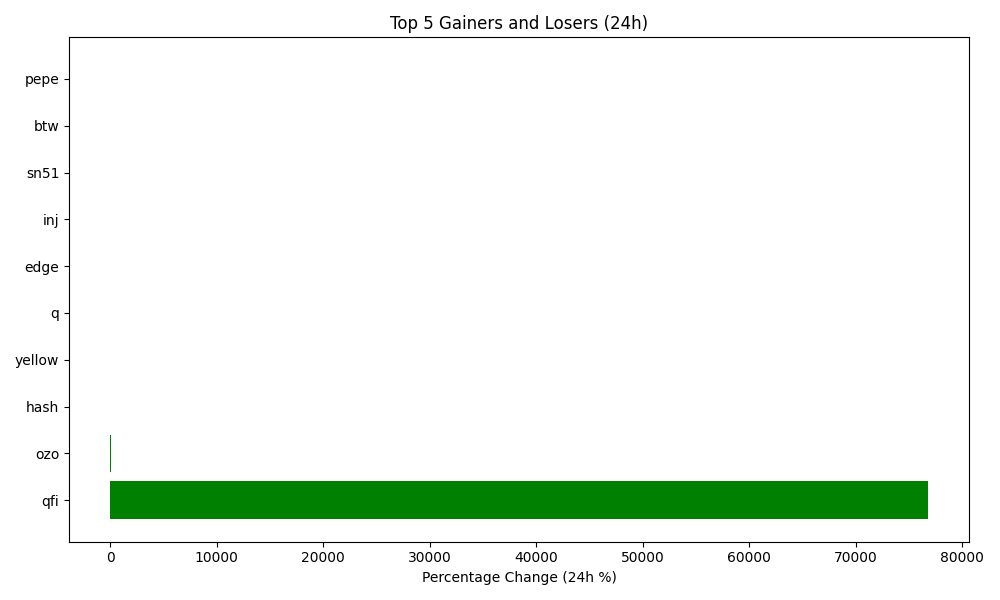

# Crypto Tracker (24h)
Author: Hitesh Agrawal

This repository automatically tracks the top 5 gaining, top 5 losing, and top 5 highest volume cryptocurrencies in the last 24 hours using the CoinGecko API, Python, Matplotlib, and GitHub Actions updates the below content everyday at midnight.

<!-- START_DYNAMIC_CONTENT -->
Last updated: 2026-11-07 03:58 UTC



**🚀 Top 5 Gainers (24h)**

| Rank | Coin | Price Change (24h %) | Volume (USD) | Current Price (USD) |
| :--: | :--: | :------------------: | :----------: | :-----------------: |
| 1 | ake | 54.47% | $66,762,100 | $0.0050 |
| 2 | geod | 19.83% | $14,525,866 | $0.2769 |
| 3 | kntq | 15.63% | $8,514,977 | $0.4880 |
| 4 | btw | 15.28% | $7,900,040 | $1.2900 |
| 5 | pieverse | 11.23% | $14,929,678 | $1.4200 |


**👇 Top 5 Losers (24h)**

| Rank | Coin | Price Change (24h %) | Volume (USD) | Current Price (USD) |
| :--: | :--: | :------------------: | :----------: | :-----------------: |
| 1 | nft | -8.32% | $10,166,750 | $0.0000 |
| 2 | cards | -8.03% | $20,716,984 | $0.2288 |
| 3 | vsn | -6.42% | $2,685,218 | $0.0331 |
| 4 | cap | -6.21% | $16,705,647 | $0.1010 |
| 5 | bat | -5.29% | $12,868,029 | $0.1237 |


**💎 Top 5 by Trade Volume (24h)**

| Rank | Coin | Price Change (24h %) | Volume (USD) | Current Price (USD) |
| :--: | :--: | :------------------: | :----------: | :-----------------: |
| 1 | usdt | 0.03% | $43,943,550,854 | $0.9992 |
| 2 | btc | 0.08% | $27,112,470,783 | $75,788.0000 |
| 3 | usdc | 0.03% | $11,573,303,835 | $0.9997 |
| 4 | eth | 0.49% | $9,932,124,230 | $2,240.8900 |
| 5 | sol | 0.36% | $2,167,857,060 | $89.8700 |


<!-- END_DYNAMIC_CONTENT -->

## How to generate the coingecko demo public api key

[coingecko-api-key-docs](https://support.coingecko.com/hc/en-us/articles/21880397454233-User-Guide-How-to-sign-up-for-CoinGecko-Demo-API-and-generate-an-API-key)

## Requirements to setup
## 1. Install uv

```bash
brew install uv
✔︎ JSON API cask.jws.json                                                                                                                                                       [Downloaded   15.1MB/ 15.1MB]
✔︎ JSON API formula.jws.json                                                                                                                                                    [Downloaded   32.1MB/ 32.1MB]
# or Linux
curl -LsSf https://astral.sh/uv/install.sh | sh
```

---

## 2. Setup Python Environment (uv)

From the project root:

```bash
uv python install 3.12
uv venv --python 3.12
source .venv/bin/activate
```

Install dependencies (locked):
```bash
uv add pandas requests matplotlib python-dotenv
```


---

## 4. Update coingecko demo key in .env ( I have provided in .env.sample)
```bash
cat .env
CGK_API_DEMO_KEY="Your-coingecko-demo-api-key-here"
```

---

## 3. To manually run the script
```bash
python3.12 main.py
```
---
