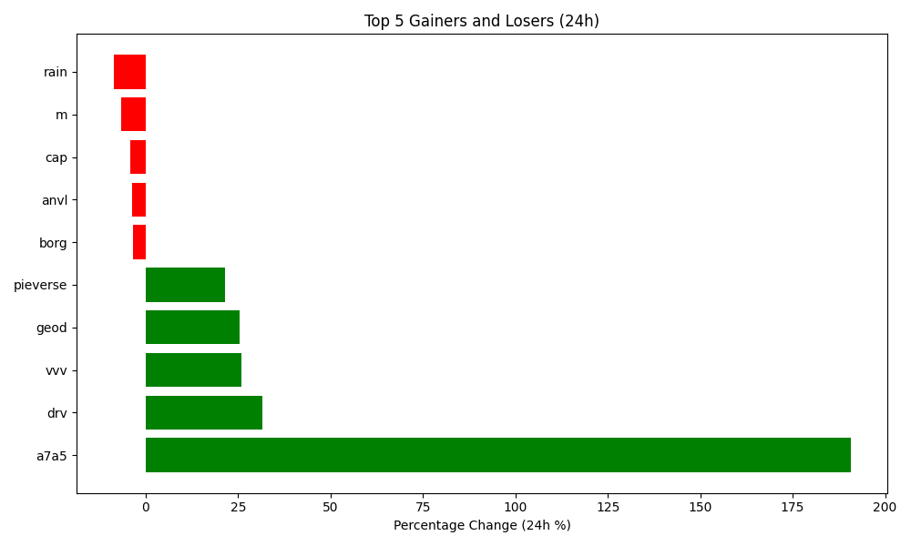

# Crypto Tracker (24h)
Author: Hitesh Agrawal

This repository automatically tracks the top 5 gaining, top 5 losing, and top 5 highest volume cryptocurrencies in the last 24 hours using the CoinGecko API, Python, Matplotlib, and GitHub Actions updates the below content everyday at midnight.

<!-- START_DYNAMIC_CONTENT -->
Last updated: 2026-11-26 06:14 UTC



**🚀 Top 5 Gainers (24h)**

| Rank | Coin | Price Change (24h %) | Volume (USD) | Current Price (USD) |
| :--: | :--: | :------------------: | :----------: | :-----------------: |
| 1 | pieverse | 33.72% | $116,292,270 | $3.9800 |
| 2 | soso | 15.65% | $4,763,502 | $0.3233 |
| 3 | btw | 12.07% | $15,111,177 | $0.9345 |
| 4 | m | 11.65% | $547,837 | $0.8510 |
| 5 | o | 11.08% | $2,521,690 | $0.6593 |


**👇 Top 5 Losers (24h)**

| Rank | Coin | Price Change (24h %) | Volume (USD) | Current Price (USD) |
| :--: | :--: | :------------------: | :----------: | :-----------------: |
| 1 | ethfi | -6.43% | $28,026,934 | $0.4351 |
| 2 | rain | -5.91% | $8,076,771 | $0.0027 |
| 3 | pearl | -3.49% | $26,375,845 | $1.9600 |
| 4 | bc | -2.64% | $107,529 | $0.0332 |
| 5 | crv | -2.59% | $40,658,704 | $0.1717 |


**💎 Top 5 by Trade Volume (24h)**

| Rank | Coin | Price Change (24h %) | Volume (USD) | Current Price (USD) |
| :--: | :--: | :------------------: | :----------: | :-----------------: |
| 1 | usdt | 0.01% | $56,230,981,069 | $0.9990 |
| 2 | btc | 2.08% | $38,650,909,673 | $60,492.0000 |
| 3 | usdc | -0.01% | $15,856,992,259 | $0.9995 |
| 4 | eth | 1.41% | $13,190,611,740 | $1,683.4700 |
| 5 | sol | 2.77% | $3,239,769,652 | $70.7100 |


<!-- END_DYNAMIC_CONTENT -->

## How to generate the coingecko demo public api key

[coingecko-api-key-docs](https://support.coingecko.com/hc/en-us/articles/21880397454233-User-Guide-How-to-sign-up-for-CoinGecko-Demo-API-and-generate-an-API-key)

## Requirements to setup
## 1. Install uv

```bash
brew install uv
✔︎ JSON API cask.jws.json                                                                                                                                                       [Downloaded   15.1MB/ 15.1MB]
✔︎ JSON API formula.jws.json                                                                                                                                                    [Downloaded   32.1MB/ 32.1MB]
# or Linux
curl -LsSf https://astral.sh/uv/install.sh | sh
```

---

## 2. Setup Python Environment (uv)

From the project root:

```bash
uv python install 3.12
uv venv --python 3.12
source .venv/bin/activate
```

Install dependencies (locked):
```bash
uv add pandas requests matplotlib python-dotenv
```


---

## 4. Update coingecko demo key in .env ( I have provided in .env.sample)
```bash
cat .env
CGK_API_DEMO_KEY="Your-coingecko-demo-api-key-here"
```

---

## 3. To manually run the script
```bash
python3.12 main.py
```
---
